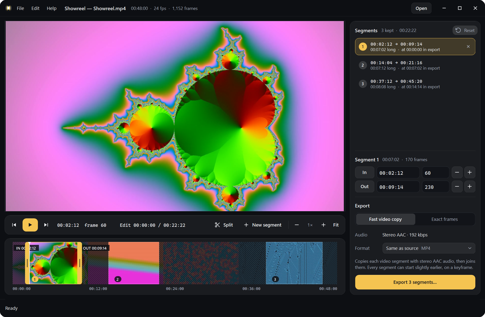
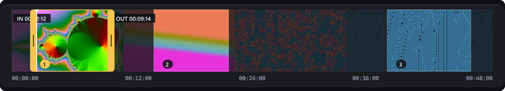
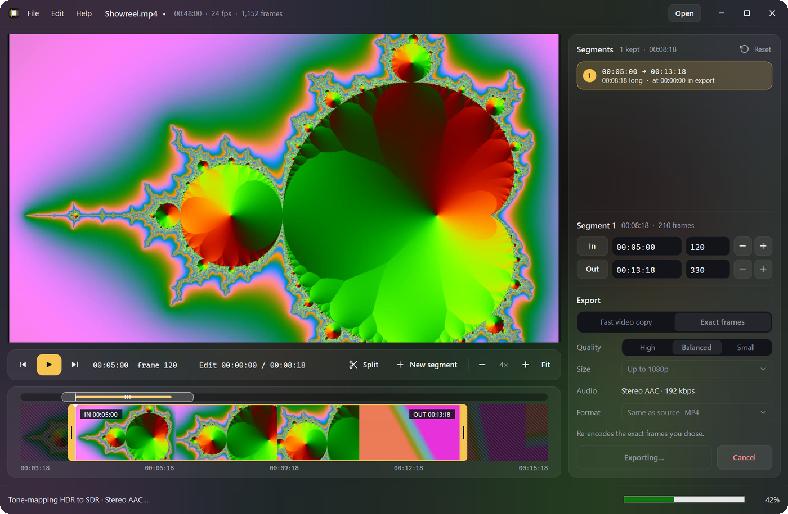
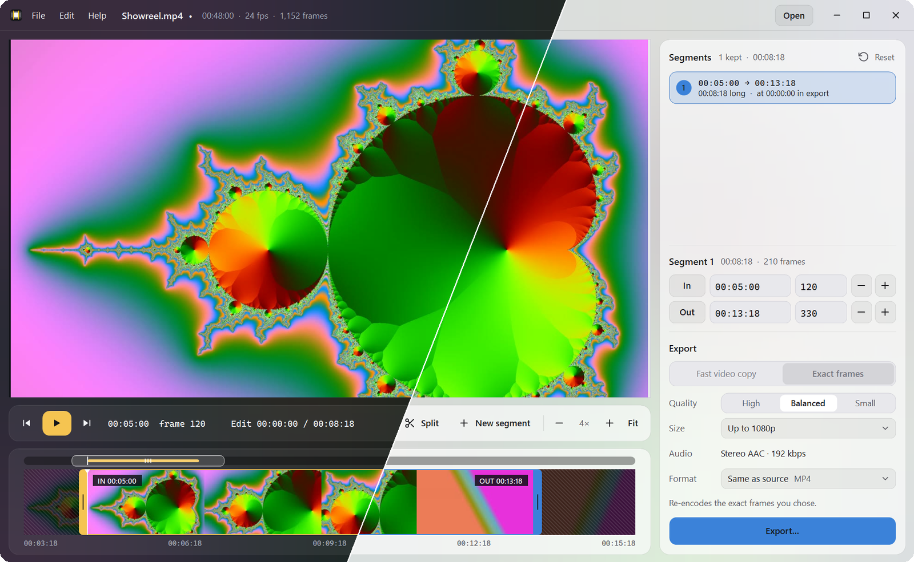
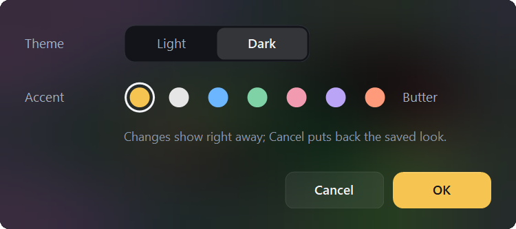
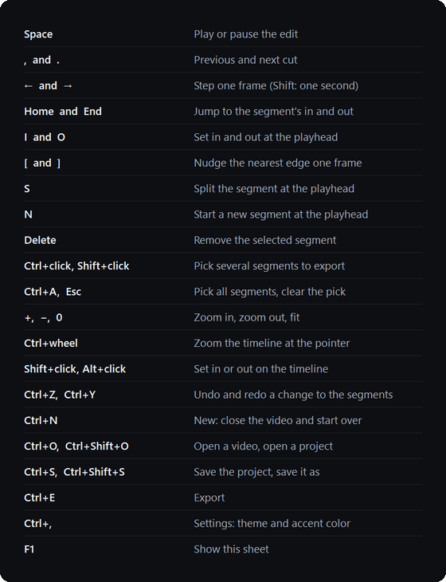

<p align="center">
  
</p>

<h1 align="center">VideoTrimmer</h1>

<p align="center">
  <b>Cut the parts you don't want. Keep the rest. Done in seconds.</b><br>
  A fast, free and open-source video trimmer for Windows that never makes you wait on a re-encode you didn't ask for.
</p>

<p align="center">
  <a href="https://github.com/dgoldwas/VideoTrimmer/releases/latest"><b>⬇ Download for Windows</b></a>
  &nbsp;·&nbsp;
  <a href="#what-you-get">Features</a>
  &nbsp;·&nbsp;
  <a href="#controls">Shortcuts</a>
</p>

<p align="center">
  <a href="https://github.com/dgoldwas/VideoTrimmer/releases/latest"></a>
  
  
  <a href="LICENSE"></a>
</p>

<p align="center">
  
</p>

Most video editors are built for making something new. VideoTrimmer is built for the job you actually have: **take a long recording, a game capture, a TV episode or a phone video, and get rid of the bits you don't want.** Drop the file in, mark what to keep, press Export. A two-hour 4K file trims in roughly the time it takes to copy it, because by default the video is never re-encoded.

## Why VideoTrimmer

- **⚡ Fast.** *Fast video copy* copies the original video stream as-is. No loss in picture quality, no waiting on an encoder, no fan noise.
- **🎯 Frame-accurate when it matters.** Switch to *Exact frames* and the cut lands on the exact frame you chose, with High, Balanced or Small quality and an optional 1080p downscale.
- **✂ Many cuts, one pass.** Keep as many segments as you like. Export them stitched into one file, or as separate numbered clips.
- **▶ Hear the joins before you commit.** Play the edit with sound, back to back, exactly as the export will join it.
- **🌈 HDR that looks right.** HDR10, HLG and Dolby Vision footage is tone-mapped to SDR automatically, in the preview and in the export, so it doesn't come out grey and washed out.
- **💬 Subtitles in the picture.** Burn text subtitles (SRT, ASS, WebVTT) or Blu-ray and DVD picture subtitles into an Exact frames export.
- **📁 Huge files welcome.** FFmpeg does the heavy lifting in the background, so even very large MKVs open quickly and never get loaded into memory.
- **🔄 Always current.** One installer, FFmpeg included, and VideoTrimmer updates itself from GitHub releases with a checksum check.

## What you get

### Cut out an ad break in seconds

Put the playhead where the break starts and press `S`. Move to where it ends and press `S` again. Select the middle segment and press `Delete`. Press `Space` a little before the join to check it. The filmstrip hatches out everything you've removed, and each kept segment gets a numbered badge so you can see the shape of your edit at a glance.

<p align="center">
  
</p>

The **Segments** sidebar lists every piece you're keeping: its in and out, its length, and where it will land in the export. Click one to fine-tune it by timecode or frame number. `Ctrl`+click a few to export just those. Drag one segment into another to merge them. Made a mistake? `Ctrl+Z`.

### Fast copy or exact frames: your call

<p align="center">
  
</p>

**Fast video copy** finishes in seconds and keeps the original picture untouched; the cut may start a moment early, on the nearest keyframe. **Exact frames** re-encodes only the parts you keep, so every cut is precise. Either way, save in the source's container or as MP4, MKV or MOV, with audio converted to stereo AAC so it plays everywhere. Progress shows in its own strip, and Cancel is always one click away.

Zoom the timeline (`Ctrl`+wheel, or `+` and `-`) to work frame by frame in a long video. An overview bar keeps the whole clip in view while you're zoomed in.

### Looks at home on your desktop

<p align="center">
  
</p>

Dark or light, with seven accent colors. The backdrop picks up a soft tint from the frame you're looking at.

<table>
  <tr>
    <td width="50%" valign="top">
      <br>
      <b>Make it yours.</b> Pick a theme and accent in Settings (<code>Ctrl+,</code>). Changes show instantly.
    </td>
    <td width="50%" valign="top">
      <br>
      <b>Keyboard first.</b> Every action has a shortcut. Press <code>F1</code> any time to see them all.
    </td>
  </tr>
</table>

### Pick up where you left off

Save your segment list as a **project** (`Ctrl+S`) and reopen it later to carry on where you stopped. A dot in the title bar tells you when something isn't saved, and VideoTrimmer asks before throwing work away.

## Get it

1. Download **`VideoTrimmer-<version>-Setup.exe`** from the [latest release](https://github.com/dgoldwas/VideoTrimmer/releases/latest).
2. Run it. FFmpeg is bundled; there's nothing else to install.
3. Right-click any video in Explorer and choose **Open with → VideoTrimmer**, or drop a file on the window.

Works with MKV, MP4, MOV, AVI, WebM, TS, M2TS, WMV and more. Requires 64-bit Windows 10 or 11.

---

## Full feature list

- Open a video by browsing, drag and drop, or Explorer's **Open with** menu.
- Scrub a filmstrip. Drag the in and out handles, or type a timecode and a frame number together. Thumbnails keep the video's shape, and the selected segment's own thumbnails run from its in frame to its out frame. When only one end is in view, its thumbnails start at that handle; a very short segment shows half of each end frame.
- **Zoom** the timeline to work frame by frame in long videos. When zoomed, an overview bar shows the whole clip; drag its thumb to pan, or click the bar to jump. The thumb never shrinks below a grabbable size.
- **Multi-cut:** keep several segments of one video. On export, choose whether to stitch them into one file or save each segment as its own numbered file (`name_01`, `name_02`, …). Split a segment at the playhead, start a new one, or delete one. Everything outside the kept segments is hatched out.
- **Segments sidebar:** every segment is listed with its in, out, length and where it lands in the export. Click one to edit its in and out below the list.
- **Output format:** save in the source's container, or as MP4, MKV or MOV. Fast video copy rewraps video when its codec fits the new container; Exact frames re-encodes. Audio becomes stereo AAC at 192 kbps in both modes.
- **Play the edit:** play/pause plays the kept segments back to back with sound, the way the export will join them. ⏮ and ⏭ skip between cuts.
- Export a fast video copy, or re-encode for exact frames. Fast video copy can start slightly early, on a keyframe.
- **HDR → SDR:** PQ/HDR10 and HLG exports automatically re-encode to SDR BT.709 using FrameGrabber's linear-light Mobius tone map. Dolby Vision uses libplacebo to apply its metadata; compatible HDR10/HLG base layers can fall back to the CPU pipeline. Dolby Vision without a compatible base layer requires a working Vulkan driver and the packaged FFmpeg. Ten-bit SDR is not mistaken for HDR.
- HDR processing also applies to still previews, the filmstrip, segment thumbnails and playback, at preview resolution.
- **Export size:** Exact frames offers Source resolution or Up to 1080p (faster). The 1080p option fits the picture inside 1920×1080 without enlarging smaller sources. Balanced uses x264 veryfast at CRF 23; High keeps the slower CRF 18 encode. A faster preset can produce larger files at the same CRF.
- Status, errors and export progress appear in a dedicated strip below the timeline. Export has a separate progress bar and percentage, and Cancel stays beside the Export button.
- Exact mode offers High / Balanced / Small quality presets and an optional copy-audio setting.
- When the source has subtitle tracks, Exact mode can burn one into the picture. Text subtitles (SRT, ASS, mov_text, WebVTT) are drawn with libass, using any fonts the file carries; picture subtitles (Blu-ray PGS, DVD, DVB) are overlaid. The burned file leaves out the subtitle streams so they do not show twice.
- Keep mapped audio tracks and supported subtitles in Fast video copy; audio tracks are downmixed individually to stereo AAC. Data tracks are omitted.
- **Settings** (**Edit** menu or `Ctrl+,`): a light or dark theme and one of seven accent colors, the same set as WB Tunes. Choices show at once; **Cancel** puts the saved look back. They are kept in `%LOCALAPPDATA%\VideoTrimmer\settings.json`.
- Installs to `C:\Program Files\WarmButter\VideoTrimmer` and updates itself from this repository's GitHub releases.

## Controls

- Click the filmstrip to move the playhead. Drag the handles to set the cut. Drag the highlighted span to slide it.
- Shift-click sets the in point. Alt-click sets the out point so the current frame is included.
- `I` and `O` do the same at the playhead. Left and Right step one frame. Shift plus an arrow steps one second. Home and End jump to the selection edges. `[` and `]` nudge the edge nearest the playhead.
- The mouse wheel steps one frame while the pointer is over the preview or the filmstrip.
- `S` (or **Split** in the dock under the preview) splits the segment under the playhead. `N` (or **New segment**) starts a new segment at the playhead that runs to the next kept segment or the end. `Delete` removes the selected segment. **Reset** keeps the whole video again. `F1` lists every shortcut.
- Click a segment in the sidebar, or click inside another segment on the filmstrip, to make it the one the handles edit.
- The **File**, **Edit** and **Help** menus sit in the title bar (`Alt` reaches them from the keyboard). **Edit → Undo** (`Ctrl+Z`) and **Redo** (`Ctrl+Y`) step through changes to the segments: trims, splits, new and removed segments, merges, Reset.
- A **project** is a video's segment list. **File → Save project** (`Ctrl+S`) writes it to a JSON file with the video's path and each segment's in and out frame; **Save project as…** (`Ctrl+Shift+S`) picks a new file. **Open project…** (`Ctrl+Shift+O`, or drop the file on the window) opens that video and restores the segments; if the video has moved, they go onto the one that is open. **New** (`Ctrl+N`) closes the video for a fresh start. A dot after the name in the title bar means unsaved changes, and VideoTrimmer asks before New, opening something else, or closing throws them away.
- To export only some segments, select several in the sidebar: `Ctrl`+click adds or removes one, `Shift`+click selects a range, and `Ctrl+A` selects all. Selected rows show a ✓ and the button changes to **Export N selected…**. Export then saves just those, stitched or as separate files. A plain click or `Esc` goes back to a single selection, and then Export uses every segment again. A segment's `×` removes it. Dragging a segment into another one merges them when you let go.
- `Space` (or a click on the preview) plays and pauses the edit from the playhead. A playhead inside a cut starts at the next kept frame. `,` and `.` jump to the previous and next cut. While playing they skip between joins; while paused they also stop at each segment's out point.
- `Ctrl`+wheel zooms the timeline around the pointer. `+`, `-` and `0` zoom in, zoom out and fit the selection to the timeline (`0` again shows the whole video). A tilt wheel or sideways touchpad swipe pans. Dragging a handle past the edge of a zoomed view scrolls it.

To remove an ad break, for example: put the playhead where it starts and press `S`, then where it ends and press `S` again. Select the middle segment in the sidebar and press `Delete`. Then press `Space` a little before the cut to check the join.

## Install

Run `VideoTrimmer-<version>-Setup.exe` from the [latest release](https://github.com/dgoldwas/VideoTrimmer/releases). It installs to `C:\Program Files\WarmButter\VideoTrimmer` with a bundled FFmpeg, adds a Start menu entry, and offers VideoTrimmer in Explorer's **Open with** menu for common video types.

Choose **Help → Check for updates** to check GitHub for a newer release. VideoTrimmer also checks shortly after it starts and every six hours. When an update exists, **Help** gets a dot and the menu item changes to **Update to …**. Choose whether to download the installer, check it against GitHub's SHA-256, close VideoTrimmer, install through a Windows permission prompt, and reopen with the same video. **About VideoTrimmer** in the same menu shows the running version.

The check reads this public repository's releases anonymously. When `VIDEOTRIMMER_GITHUB_TOKEN`, `GH_TOKEN`, `GITHUB_TOKEN` or a GitHub CLI sign-in is available it is used too, which raises GitHub's rate limit.

## Run from source

Download or build a Windows version of FFmpeg that includes both `ffmpeg.exe` and `ffprobe.exe`. Put both executables beside `VideoTrimmer.exe`, in a `tools` subfolder beside it, or in a directory on `PATH`. Then launch `VideoTrimmer.exe`.

The FFmpeg executables used during development are intentionally not committed: each is over 100 MB. The app can also use a local FFmpeg installation. FFmpeg builds may have their own licensing terms; see [FFmpeg Legal](https://ffmpeg.org/legal.html) and the distribution's license notices.

## Build from source

Requirements: Windows, the .NET 8 SDK, and FFmpeg/FFprobe available locally as described above.

```powershell
dotnet build .\VideoTrimmer.csproj -c Release
dotnet publish .\VideoTrimmer.csproj -c Release -r win-x64 --self-contained true -p:PublishSingleFile=true -p:IncludeNativeLibrariesForSelfExtract=true -o .\publish\win-x64
Copy-Item .\tools\ffmpeg.exe, .\tools\ffprobe.exe .\publish\win-x64\ -Force
```

The project targets `net8.0-windows` and requires Windows Forms. The portable folder is `publish\win-x64\` (gitignored): a single-file `VideoTrimmer.exe` with `ffmpeg.exe` and `ffprobe.exe` beside it. FFmpeg can also live in a `tools` subfolder or on `PATH`.

## Releases

The project's `<Version>` (YYYY.MM.DD.##) is the only place the version is set. Bump it, then:

```powershell
.\build-installer.ps1            # publish, bundle FFmpeg, build artifacts\VideoTrimmer-<version>-Setup.exe
.\build-installer.ps1 -Install   # ...and install it into Program Files
.\build-installer.ps1 -Release   # ...and publish it as GitHub release v<version>, which installed copies pick up
```

`VideoTrimmer.exe --render <folder>` makes a short test clip and saves pictures of the window in its main states (empty, loaded, trimmed, Exact mode, zoomed, exporting), the title bar, the File and Edit menus, the shortcuts sheet and Settings, then the light theme, for checking the UI without clicking through it.

`VideoTrimmer.exe --render-project <project.json> <folder>` checks reopening a supplied project without changing it, saves processed/unprocessed preview comparisons, and silently exercises the playback decoder. `dotnet run --project tests/ExportVerification.csproj -- --project <project.json> <folder>` verifies full separate and stitched 1080p exports against the saved frame counts, output color tags and stream counts; use the packaged FFmpeg on `PATH`. These diagnostics write only to the requested output folder.

`build.ps1` runs the `--check` self-test on the published exe and bundles a pinned, checksum-verified GPL FFmpeg build from [BtbN/FFmpeg-Builds](https://github.com/BtbN/FFmpeg-Builds) into `tools\`. Exact-frame export needs libx264, which LGPL builds leave out. The installer needs [Inno Setup 6](https://jrsoftware.org/isinfo.php). The icon comes from `assets\make-icon.ps1`.

## Trimming behavior

Fast copy avoids video re-encoding and is quick, but it can only start cleanly on a keyframe. The output may therefore begin slightly before the selected time. Exact frames re-encodes video to honor the requested frame boundaries; it is slower and the output can differ in quality. Always review exported media before relying on it.

With several segments, Fast video copy saves each part beside the output (in a hidden `.<name>.parts` folder that is removed afterwards), copying its video and converting its audio to stereo AAC, then joins the parts with FFmpeg's concat demuxer. Every segment can start on an earlier keyframe. Exact frames opens and seeks the input separately for each segment, then joins the decoded sections in one re-encode. That re-encode keeps only the first video and audio track. HDR processing runs on each selected section before subtitle burn-in and joining; it never requires a whole-film conversion. Color detection reads stream metadata, with at most eight opening video packets decoded if transfer tags are missing.

Exact exports exclude attached cover pictures from the video encoder. Same-container separate cuts retain audio/subtitle tracks and font attachments, with subtitles/fonts copied and audio converted to stereo. Input reads are bounded to the cut; export progress uses video frames so sparse subtitle timestamps cannot advance it to 100% early. The [HandBrake comparison](docs/export-performance.md) explains the confirmed poster stall and subtitle read-ahead, plus the settings that affect encoding speed. Text subtitle burn-in uses libass, which separately reads the source subtitle track during filter initialization.

Run the real export checks with `dotnet run --project tests/ExportVerification.csproj`, with the packaged FFmpeg tools on `PATH`. This generates a small-resolution one-hour PQ/5.1 source under `artifacts/hdr-export-check`, exports late cuts through CPU and available libplacebo paths, and checks SDR tags, removal of HDR metadata, duration, separate/stitched cuts, HLG without audio, and center-channel audio reaching both stereo channels. It does not replace visual acceptance on real Dolby Vision footage.

The audio waveform under the filmstrip is turned off for now (`WaveformEnabled` in `MainForm.cs`), because reading it demuxes the whole file. When on, it is read once per video from the first audio track, decoded to 8 kHz mono. Playing the edit decodes each kept segment with FFmpeg at preview size (up to 960 pixels wide) and its audio as 48 kHz PCM, played through [NAudio](https://github.com/naudio/NAudio) (MIT). The next segment is decoded ahead so joins play without a gap. Preview playback is for checking cuts; the export is what to judge picture quality by.

## Repository contents

- `MainForm.cs`, `Program.cs`, and `VideoTrimmer.csproj`: application entry, main window, and project definition.
- `Theme.cs`, `Glass.cs`, `UiControls.cs`, `TimelineControl.cs`: colors and fonts, the frame-tinted backdrop and glass painting, custom controls, and the filmstrip timeline.
- `ExportModeCopy.cs`, `ExactExportOptions.cs`, `OutputFormat.cs`: export-mode copy, presets, and output containers.
- `TimeMath.cs`, `FfmpegRunner.cs`, `MediaProbe.cs`, `StillCapture.cs`, `FilmstripService.cs`, `ExportService.cs`: frame math, FFmpeg helpers, probe, stills, filmstrip, and export plans.
- `CutList.cs`, `AudioWaveform.cs`, `EditPlayer.cs`: multi-cut segments, the waveform, and playback of the edit.
- `UpdateService.cs`, `MainForm.Updates.cs`: GitHub release checks and the self-update flow.
- `build.ps1`, `build-installer.ps1`, `installer\VideoTrimmer.iss`, `assets\`: release build, installer, and icon.
- `tools/README.md`: notes about optional local FFmpeg executables.
- `UPDATE.md`: changelog and packaging notes.

Generated build folders, published binaries, and the local sample video are excluded from Git.

## License

VideoTrimmer is released under the [MIT License](LICENSE).

The installer and portable build bundle FFmpeg and FFprobe from [BtbN/FFmpeg-Builds](https://github.com/BtbN/FFmpeg-Builds). These are GPL builds, licensed separately under their own terms; see [FFmpeg Legal](https://ffmpeg.org/legal.html). VideoTrimmer runs them as separate programs and does not link to them. Playback uses [NAudio](https://github.com/naudio/NAudio) (MIT).
